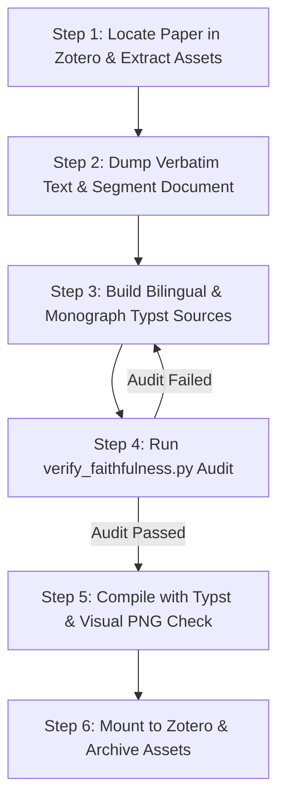

# Academic Paper Translator (Zotero-Integrated Publication Edition)

Translate complete academic papers into faithful, publication-grade **Side-by-Side Bilingual (`_bilingual.pdf`)** and **Chinese Monograph (`_zh.pdf`)** editions, and automatically mount them under the corresponding local Zotero item.

---

## The Six Ironclad Fidelity Invariants (六大保真铁律)

To guarantee absolute academic fidelity and prevent LLM rewriting, omissions, and data hallucinations, every translation MUST strictly enforce the following six invariants:

### 1. Verbatim Immutable English in Bilingual Editions (双语版英文不可变真值铁律)
- In the bilingual edition (`#bipara([en], [zh])` and `_bilingual.md`), the English column **MUST be an exact, 100% character-for-character verbatim stream** of the original publication.
- **Strictly Prohibited**: Rephrasing, summarizing, "improving", condensing, or reorganizing the English text (e.g., replacing "Section 2 summarizes the model... Section 3 describes..." with section title citations is strictly forbidden).

### 2. Zero Omission & Paragraph Count Conservation (零删减与段落数量绝对守恒)
- Every single paragraph, sentence, and technical argument must be translated 1:1.
- **Strictly Prohibited**: Dropping physical derivations between equations (e.g., wide-lane rounding, virtual observations, ILS, and LAMBDA transformations), omitting transitional error curve analysis (e.g., local increase in FFRT error near epoch 100), or merging multiple paragraphs into one.

### 3. Numerical, Statistical & Tolerance Precision (数值、公差与统计口径绝对保真)
- **Format Invariance**: Original decimals MUST remain decimals; original percentages MUST remain percentages. Never convert numbers (e.g., changing `0.9014 ± 0.0028` into `90.14 ± 0.28%` is forbidden).
- **Zero Mental Math**: Statistical quantities, epoch counts, and ratios (e.g., ~0.3M / ~5M ≈ 5.6%) must match the published text exactly; never invent approximate percentages (e.g., guessing "8–9%").
- **Tolerances & Metrics**: Every `±` tolerance, metric name (Mean, RMS, P95), and hyperparameter ($\kappa$, $\eta$) must be preserved. Official author errata in the printed paper should be retained as-is, with an optional translator footnote `[注: 原文印刷为...]`.

### 4. Strict Sectional Hierarchy & Anchor Placement (章节从属树状结构绝对锚定)
- Floating tables and figures must remain anchored in their **authorial home section/subsection**, exactly matching the published paper structure (e.g., Table 5 belongs at the end of Section 5.4 Discussion, NEVER prematurely moved into Section 5.3).
- Subsection introductory paragraphs must immediately follow the subsection heading, never be pushed into the previous subsection.
- Never add unoriginal transitional filler sentences before tables (e.g., "Table 5 summarizes the classification metrics...").

### 5. Complete 8-Item Backmatter Checklist (文末声明与学者简介八大要素全量清单)
Every paper translation must include the complete backmatter:
1. **Acknowledgements (致谢)**
2. **Author contributions (作者贡献声明)**: Preserve every author's specific role abbreviations (e.g., H Z, L W, Y L, etc.).
3. **Funding (基金与资助支持)**: Preserve all grant titles and project IDs.
4. **Data availability / Code availability (数据与代码可用性说明)**
5. **Competing interests / Ethics declarations (利益冲突与伦理声明)**
6. **Publisher's note (出版商中立声明与版权协议)**
7. **Author Biographies (全部作者个人学术履历简介)**: Include detailed bios and research areas for all authors.
8. **References (规范参考文献)**: Preserve all entries.

### 6. Citation Hygiene & Reference Styling (引文样式与清洗规范)
- **Scraping Sanitization**: Completely scrub web-scraping pollution such as `[CAS]`, `[PubMed]`, `Article Google Scholar`, and database tags from reference entries.
- **URL Repair**: Fix broken DOI URLs caused by PDF line-wrapping (remove whitespace inside URLs).
- **Journal Citation Style**: Match the publication's authentic citation style (e.g., Springer/Nature uses Author-Year with hanging indent and NO `[1]` numbers; IEEE uses bracketed numbered citations).

---

## Typesetting & Typst Formatting Standards

1. **Mathematical Formulas (Inline vs. Display)**:
   - **Inline math** MUST remain strictly inline inside paragraphs (`$expr$` with NO spaces inside the dollar signs and NO outer `{...}` braces, as `{...}` in Typst renders literal visible curly braces).
   - Multi-letter upright identifiers must be pre-declared in Typst (e.g., `#let sys = math.upright("sys")`, `#let IF = math.upright("IF")`, `#let fix = math.upright("fix")`, `#let float = math.upright("float")`).
   - **Display equations** use numbered block math (`#set math.equation(numbering: "(1)")`) matching the original paper's exact numbering.
2. **Three-Line Booktabs Tables**:
   - All tables must follow standard publication-grade booktabs styling (`table.hline(stroke: 1.2pt)` top/bottom, `0.6pt` mid-rule) with light alternating fills.
3. **Figures & Verbatim Captions**:
   - Extract high-resolution figures via `scripts/extract_figures.py` (supporting side-captions and multi-column figures).
   - Figure captions in bilingual editions MUST pair the 100% verbatim English caption with its faithful Chinese translation.
4. **Metadata & Affiliations**:
   - Preserve complete author names, superscript indices (`#super[1,2]`), corresponding author asterisks (`#super[1\*]`, escaped as `\*`), emails (`\@` escaped), and full institutional addresses/postcodes.

---

## Standard Production Workflow



### Step 1: Locate Paper in Zotero & Extract Assets
Search local Zotero database (`E:\Document\Zotero\zotero.sqlite`) by title or DOI:
```bash
python "C:\Users\28048\.gemini\config\skills\academic-paper-translator\scripts\zotero_mount.py" --find "<Paper Title or DOI>"
```
Extract high-resolution figures:
```bash
python "C:\Users\28048\.gemini\config\skills\academic-paper-translator\scripts\extract_figures.py" "<path-to-pdf>" --out "paper_figures"
```

### Step 2: Dump Verbatim Text & Segment Document
Dump the complete raw text from the original PDF to `original_pdf_full_text.txt`. This text serves as the immutable ground truth for all English content.

### Step 3: Build Bilingual & Chinese Monograph Editions
Generate:
- `<Title>_bilingual.typ`: Side-by-side `#bipara([en], [zh])` where `en` is 100% verbatim from `original_pdf_full_text.txt`.
- `<Title>_zh.typ`: Chinese academic monograph edition (`Source Han Serif SC`, `first-line-indent: 2em`).
- `<Title>_bilingual.md` & `<Title>_zh.md`.

### Step 4: Run Automated Faithfulness Audit
Before compiling, run the built-in auditor to verify the 6 Ironclad Invariants:
```bash
python "C:\Users\28048\.gemini\config\skills\academic-paper-translator\scripts\verify_faithfulness.py" --typst "<Title>_bilingual.typ" --source "original_pdf_full_text.txt" --mode bi
python "C:\Users\28048\.gemini\config\skills\academic-paper-translator\scripts\verify_faithfulness.py" --typst "<Title>_zh.typ" --mode zh
```
> [!IMPORTANT]
> If `verify_faithfulness.py` exits with code 1 (audit failed), compilation MUST NOT proceed. Review the printed mismatches and rectify the text immediately.

### Step 5: Compile with Typst & Perform Visual Inspection
Compile the PDFs:
```bash
typst compile "<Title>_bilingual.typ" "<Title>_bilingual.pdf"
typst compile "<Title>_zh.typ" "<Title>_zh.pdf"
```
Render preview PNGs for key pages (Page 1 title/abstract, equations, tables, disagreement analysis, backmatter) using `fitz` (`pymupdf`) and visually inspect for layout integrity.

### Step 6: Automatic Zotero Local Attachment Mounting
Mount the compiled PDFs to the target Zotero item:
```bash
python "C:\Users\28048\.gemini\config\skills\academic-paper-translator\scripts\zotero_mount.py" --parent-id <itemID> --bilingual "<Title>_bilingual.pdf" --zh "<Title>_zh.pdf"
```
Archive the `.typ` sources, `.md` files, and extracted figures directory into the parent item's storage directory.
